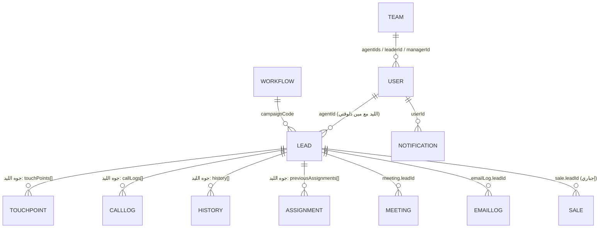

# الداتا ماشية إزاي من أول لآخر

## 1) الجداول (collections) وإيه المرتبط بإيه

الـ `AppState` فيه 11 "جدول" (arrays). العلاقات بالـ id:



- **الليد هو قلب النظام**: الـ touch points والـ call logs والـ history كلهم **جوه** object الليد نفسه (مش جداول منفصلة).
- `Workflow` = **القالب** (Activation و Retention دلوقتي 7 خطوات: Email فوراً ← Call بعد يوم ← Email بعد يوم ← Call بعد يومين ← Email بعد يومين ← Call بعد يومين ← Email فوراً). الـ Admin يقدر يعمل campaign جديدة ويحدد الخطوات ونوعها والأيام بينها من صفحة Campaigns، والتعديل بيسري على الليدز اللي بتتاخد بعده بس. كل ليد ياخد **نسخة** منه عند الاستلام.
- الربط مع الـ workflow بـ `campaignCode` (`ACT-001`, `RET-002`).

## 2) شكل الليد (مختصر)

```ts
Lead {
  id, leadCode, campaignCode, companyName, contactName, phone, email,
  agentId: ''            // '' = في الـ pool مفيش حد ماسكه
  status: 'new'|'discovery'|'lvm'|'nvm'|'no_response'  // 'arranged_meeting' قديم، مابقاش بيتحط
  touchPoints: [{ order, type:'call'|'email', label, dayOffset, status, dueDate, completedAt }]
  currentTouchPoint: 0   // order الخطوة اللي مستنيها دلوقتي (-1 = خلص كله)
  callLogs: [{ type:'nvm'|'lvm'|'discovery', description, round, ... }]
  history:  [{ action, userName, round, detail ... }]     // سجل كل حاجة حصلت
  stopped, removedFromQueue, expiredAt                     // أعلام الحالة
  round: 1                                                 // رقم الدورة (بيزيد مع كل agent جديد)
  previousAssignments: [{ round, agentName, touchPoints }] // نسخة متجمدة من شغل الـ agent القديم
  discoveryReached, lastActivityAt
}
```

أنواع المكالمات (زي ما بتظهر في شاشة تسجيل المكالمة): **nvm** = No Voicemail (محدش رد ومفيش voicemail) · **lvm** = Left Voicemail (سبت voicemail) · **discovery** = Client Responded (العميل رد). الترتيب في التصنيف: `discovery > lvm > nvm`.
حالة الـ touch point: `pending` → `completed` أو `skipped` (و`overdue` لو فات ميعاده).

## 3) دورة حياة الليد

```mermaid
flowchart TD
  A[Admin يضيف الليد: addLeadsToPool<br/>agentId='' ، touchPoints=[]] --> B[(Pool)]
  B -->|Agent: takeLeadsFromPool| C[الليد بقى بتاعه<br/>round=1 ، touchPoints = نسخة من الـ workflow<br/>TP0 due دلوقتي]
  C --> D{الخطوة الحالية}
  D -->|call| E[logCallAndCompleteTouchPoint<br/>بيسجل المكالمة + يكمّل الخطوة مع بعض]
  D -->|email| F[sendEmailForLead أو الإيميل التلقائي]
  D -->|skip| G[skipTouchPoint ← ممكن restore]
  E --> H[pointLeadAtFirstOpenTouchPoint<br/>يروح لأول خطوة مفتوحة ويحسب ميعادها]
  F --> H
  G --> H
  H --> D
  H -->|مفيش خطوات مفتوحة| Z[Workflow finished]
```

### الـ touch point بيتحرك إزاي
1. عند الاستلام: كل الخطوات `pending`، الخطوة 0 ميعادها **دلوقتي**، والباقي `الآن + dayOffset`.
2. لما الـ agent يخلّص خطوة: بتبقى `completed`، والخطوة اللي بعدها ميعادها = **الفرق بين الـ dayOffset بتاعها وبتاع اللي قبلها**، محسوب من **لحظة التخليص** (مش من يوم الاستلام).
3. الـ `currentTouchPoint` دايماً بيشاور على أول خطوة مفتوحة.
4. الـ Work Queue بيصنّف الليد حسب ميعاد خطوته: **Today** (النهاردة أو متأخر) / **Next** (بكره أو بعد) / **Stop** (الـ agent وقّفه) / **Finished**.
5. جوه كل خطوة بيتقسم حسب أحسن نتيجة مكالمة: `discovery > lvm > nvm`، والـ meeting **مش** category: الليد اللي معمولّه meeting بيفضل في خطوته الحالية كـ **Discovery** عادي، والـ touch points ماتتغيّرش. الـ meeting بيظهر في الـ Calendar وفي "Arranged Meetings — Today" بس.

## 4) لما الـ Agent يستلم الليد وبعدين الليد يتشال/يتحول

| الحالة | اللي بيحصل | الداتا بتتحفظ فين |
|---|---|---|
| **Agent يعمل Remove** (`removeLeadFromAgentQueue`) | `removedFromQueue=true`, `stopped=true`. الليد يرجع للـ pool والـ id بتاعه يتحرر. الـ history والمكالمات محفوظين. | على الليد نفسه |
| **حد تاني ياخده من الـ pool** (`takeLeadsFromPool`) | شغل الـ agent القديم بيتجمّد في `previousAssignments` (round 1)، والليد يبدأ `round = 2` بـ touch points جديدة تماماً. | نسخة القديم في `previousAssignments` |
| **TL أو OM يحوّله** (`transferLeadToAgent`) | نفس الفكرة: تجميد القديم، round جديد، workflow جديد للـ agent الجديد. الصلاحية: OM أو TL بتاع الـ agent اللي ماسكه بس، والمستلم لازم agent. | `previousAssignments` + `history.transfer` فيها كام خطوة اتعملت (مثلاً 3/6) |
| **قاعدة الـ 15 يوم** (`runLeadExpiryJob`) | لو مفيش تقدم 15 يوم تقويمي (ولا meeting جاي ولا سيلة): الليد يطلع من workflow الـ agent ويرجع **حر** في الـ pool (`removedFromQueue=true`، الـ id يتحرر، التاريخ محفوظ). الليدز القديمة اللي عليها `expiredAt` لسه بتتحول بالـ TL. | على الليد |
| **خلص كل الـ touch points** (`runWorkflowFinishedJob`) | لما كل الخطوات تتعمل (أو تتعمل skip) الليد يطلع من الـ workflow ويرجع حر في الـ pool، إلا لو فيه meeting جاي أو سيلة. | على الليد |
| **قاعدة "اتشغّل من قريب"** (`daysUntilTakeable`) | ليد حر لكن آخر مكالمة/إيميل عليه من agent **تاني** كانت من أقل من 15 يوم: مينفعش يتاخد (`takeLeadsFromPool` بيرفضه والـ UI بيقول فاضل كام يوم). الـ agent اللي اشتغل عليه آخر مرة ممكن ياخده تاني. | — |
| **Stop / Resume** | `stopped=true/false`، وبيحدّث `lastActivityAt` (بيصفّر عدّاد الـ 15 يوم). Expired مفيش resume، بس transfer. | على الليد |
| **Delete permanently** | بيتمسح، ومتاح بس لو مفيش sale عليه. الـ meetings بتاعته بتتلغي. | — |

الـ `round` بيتحط على كل call log وكل سطر history، فتقدر تعرف أي agent عمل إيه وفي أنهي دورة. التحليلات (`currentRoundCalls`) بتحسب بس مكالمات الدورة الحالية.

## 5) اللي بيحصل لوحده (Scheduler — كل 30 ثانية والـ app مفتوح)

بيتشغّل من `useSchedulerTick` ← `runScheduledJobs` ← الـ 4 jobs في `store/crm/scheduler/`:

1. `meetingDayEndJob`: يوم الـ meeting عدّى من غير نتيجة ← الليد يرجع لـ queue الـ Discovery.
2. `leadExpiryJob`: قاعدة الـ 15 يوم.
3. `meetingReminderJob`: إشعار قبل الـ meeting بـ 15 دقيقة (مرة واحدة بس).
4. `autoEmailJob`: خطوة email جه ميعادها ← النظام يبعتها (قالب Discovery لو الليد وصل discovery وإلا No Response). لو الليد مفيهوش email أو الخطوة الحالية call، مبيبعتش. ومفيش إيميل يتبعت مرتين لنفس الخطوة (`idempotencyKey`).

> الإرسال محاكاة: بيتسجل في `emailLogs` بس مش بيتبعت فعلاً. ولما تبني backend حقيقي، الـ jobs دي هتبقى background jobs.

## 6) الحفظ

`startStatePersistence` بيسمع على كل تغيير في الـ store ← يحفظ في localStorage بعد 150ms (debounce) ← ويحفظ فوراً لما التاب يتقفل. لو تاب تاني غيّر الداتا بياخدها (`applyStateFromOtherTab`) مع الحفاظ على الـ user المسجل في التاب ده. لو المتصفح رفض الحفظ بيظهر `StorageBanner` مع زر Backup. أول مرة (أو داتا بايظة) بيبدأ من `createInitialState` (الـ seed).

## 7) الـ Meeting مع ليد (من نسخة الـ outcome)

- الـ `Meeting` (النوع `lead_meeting` أو `internal_meeting`، والحالة `arranged` / `completed` / `no_show` / `cancelled` / `rescheduled`) ليه حقل `outcome` (وصف اللي حصل). **إجباري** لما meeting مع ليد يتعمله `completed` (الـ UI بيطلبه والـ store بيرفض من غيره). الـ meeting الداخلي مش محتاجه.
- الـ outcome بيتحفظ على الـ meeting وبيتكتب كمان في `history` بتاع الليد (`meeting_completed`).
- **Reschedule**: بيفتح فورم Schedule ببيانات نفس الميتنج (الليد، الناس، العنوان، المدة، الأجندة) تختار وقت تاني. الميتنج الجديد بيتعمل الأول ثم القديم بيتقفل `rescheduled`، والليد في الـ Work Queue ماليهوش علاقة بالعملية دي (بيفضل Discovery).
- **Schedule another meeting with this lead**: نفس الفورم بنفس البيانات لميتنج إضافي، وكمان متاح من زرار "Save & schedule next meeting" بعد كتابة الـ outcome.

## 8) السيلز (Sales)

- **اللي بيسجل ويمسح السيلز هو دور Quality بس** (`recordSale` / `deleteSale`)، والـ store بيرفض أي دور تاني.
- السيلة لازم تتربط بليد حقيقي (`leadId` إجباري). اسم الشركة بيتنسخ على السيلة (`leadName`) للعرض بس، لأن الأسماء ممكن تتكرر.
- الليد الواحد ممكن يجيب **أكتر من سيلة** (أنواع مختلفة أو نفس النوع في أيام مختلفة).
- الأنواع: `BP, PPI, MUA, ATEP, Activation, Retention, Transition`. الداتا القديمة (`new/upsell/renewal`) بتتحول تلقائياً وقت القراءة (`saleMigration.ts`).
- الـ target الشهري: **28 سيلة لكل agent**، وللتيم = عدد الأجنتس × 28، وللـ OM مجموع تيماته.
- مينفعش يتمسح ليد عليه سيلة (`deleteLeadsAsAdmin` بيسيبه).
- شرح الصفحة وصلاحيات العرض في `SALES.md`.

## 9) الصلاحيات حسب الدور

شوف `ROLES_AND_PAGES.md`.
